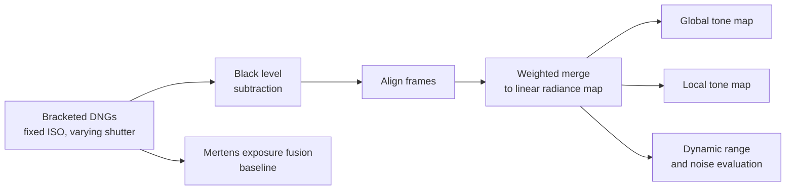

# EE513 Project 3: Bracketed-Exposure HDR Pipeline

**Track A, Computational Photography**

> **Status: proposal stage.** No Project 3 captures yet. Sections marked _TODO_ will be filled in as the project progresses.

## What inspired this project

This project was inspired by the line "I simply blended them in using the HDR in Lightroom" from the landscape photography video below, because if Lightroom's HDR functionality were that simple, it would be a lot more common.

[](https://youtu.be/21cnEBHd9go?t=129)

_Click the thumbnail to watch, starting at the relevant moment._

## What I'm building

A bracketed-exposure HDR pipeline that aligns raw frames, merges them into a linear radiance map with a weighted average, and tone maps it globally and locally. I will measure how many stops of dynamic range it recovers beyond a single frame from the same camera.



## Data

iPhone 16 Pro Max 1x camera, Adobe Lightroom iOS app, DNG, manual shutter time (1/10000 s to 1 s), with ISO, white balance, and focus locked. The scene is a static indoor scene that I light myself, with a bright source beside a dark region and a matte white card for linearity patches.

**I have no Project 3 captures yet.** I need:

- a white-sheet linearity test
- a tripod bracket at 1-stop spacing (about 12 frames, with repeats)
- flat-field pairs for the PTC
- a handheld bracket for alignment
- a capture log per shoot

I may reuse my Project 1 dark-field pairs only if the ISO, app, and DNG mode match. Otherwise I will reshoot them.

Raw captures are not committed to this repository (see `.gitignore`). A small cropped sample is committed so the pipeline can run without the full data. _(TODO: capture procedure and sample data description.)_

## Baseline

1. **Mertens exposure fusion** (classical, no radiance map). It cannot give a stops-of-range number, so I compare it on crops, local contrast, and noise in flat regions.
2. **Best single frame** from the bracket with a tuned single-exposure development. This is the floor.

Alignment will be the burst-alignment code from Project 2, which I have not written yet. I will finish it first, and until then I use tripod brackets, which need little or no alignment.

## Metric and operating point

Every number carries a bootstrap 95% confidence interval, with the method stated in the report.

- **Headline: usable dynamic range at SNR ≥ 1**, the same criterion as Project 1, where I measured **10.93 ± 0.01 stops (65.8 dB)**. The noise floor comes from the same method: a photon transfer curve (PTC) fitted below 10% saturation, from flat-field and dark-field pairs. I remeasure the single-frame range on this bracket's own frames with that method, and propagate the PTC noise model through the merge to get the merged range.
- **Secondary:** the same measurement at SNR ≥ 10, for both the single frame and the merged result, since SNR ≥ 1 is generous.
- **Expected gain.** The 1 s to 1/10000 s shutter range is about 13.3 stops, which is a ceiling and not a prediction. The scene and noise floor limit what I can show, so I expect a gain of a few stops and will report what I measure.
- **Linearity:** the residual of signal vs. exposure time on a patch that never clips.
- **Noise:** merged-radiance noise against a many-frame tripod average, with the reference's own residual noise reported.

## Results

_(TODO: fill in once evaluation is complete.)_

| Method                         | Dynamic range, SNR ≥ 1 (stops) | Dynamic range, SNR ≥ 10 (stops) | Noise vs. tripod reference | Time (s) |
| ------------------------------ | ------------------------------ | ------------------------------- | -------------------------- | -------- |
| Single frame                   | TODO                           | TODO                            | TODO                       | TODO     |
| Mertens fusion                 | n/a                            | n/a                             | TODO                       | TODO     |
| Merged radiance (this project) | TODO                           | TODO                            | TODO                       | TODO     |

_(TODO: before and after image.)_

## Deployed artifact

A command-line tool that processes a folder of DNGs and writes the radiance map plus global and local tone-mapped images. The pipeline is entirely classical, so I report mean end-to-end time over repeated runs with spread (first run discarded), per-stage timings, image size, and laptop CPU. A committed `.npy` crop sample supports the one-command reproduction, and the data folder is in `.gitignore` from the first local commit.

**One-command reproduction:** _(TODO)_

```bash
# TODO: e.g. uv run python -m hdr.cli --input samples/ --output out/
```

## Biggest risk

The DNGs may not be linear raw (ProRAW-style processing), which would break the linearity assumption and the PTC fit. In the first session I run the white-sheet linearity test and check the first and last frames at full zoom. If the files are not linear, I report that as a finding, add a measured tone curve to the black-level step, and reshoot within week 1.

## Failure analysis and fabrication

_(TODO: at least three failure crops, and a paragraph on where the merge could invent or erase detail, such as averaging away moving objects, and how I checked.)_

## Repository layout

_(TODO)_

## Acknowledgments

This project builds on course material from **Professor James McNames** (EE513), including lecture content and the course Jupyter notebooks. Code borrowed or adapted from those notebooks is credited to him in the source files where it is used. It also reuses code from my own earlier projects: [Project 1](https://github.com/valefleur/EE513_Project1) and [Project 2](https://github.com/valefleur/EE513_Project2).

## References

- T. Mertens, J. Kautz, F. Van Reeth, "Exposure Fusion," 2007.
